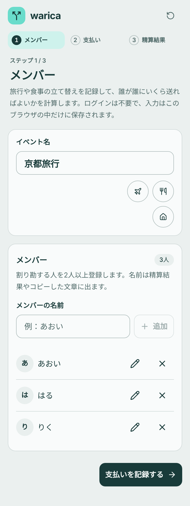
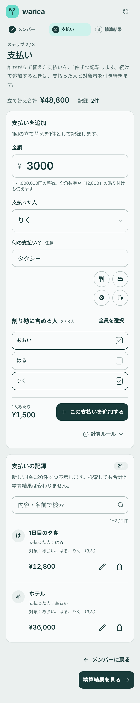
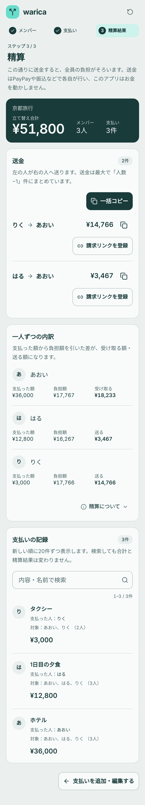
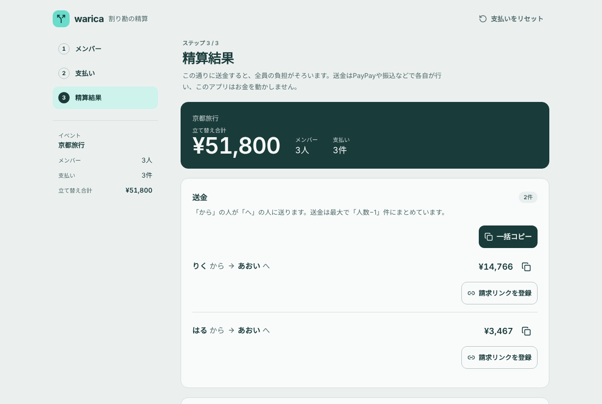
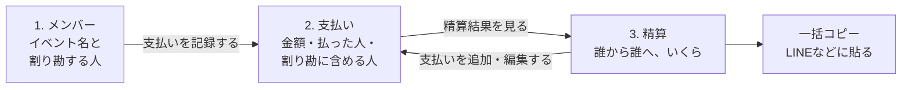
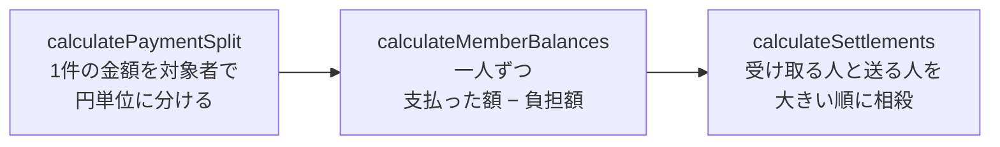
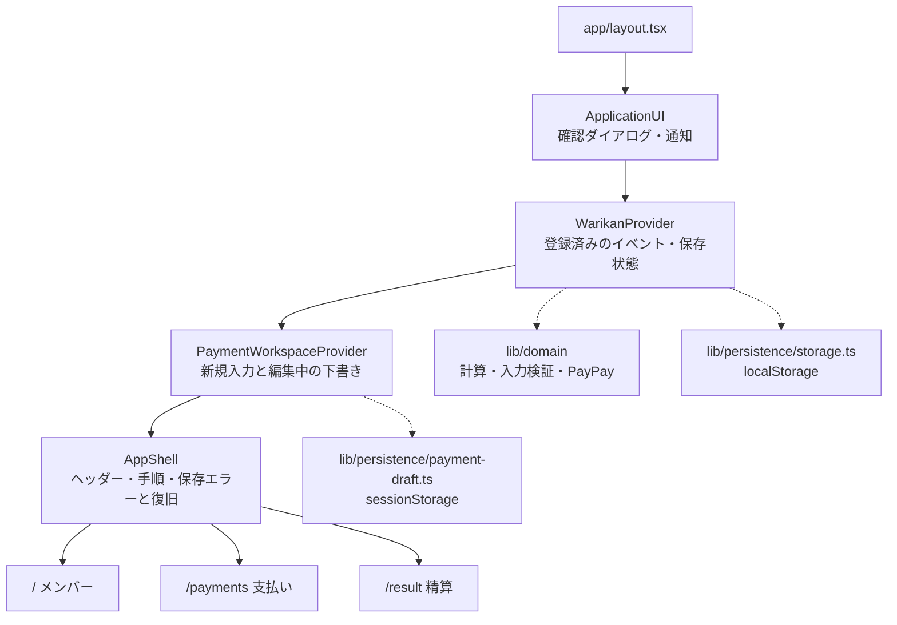

# WARICA

旅行や食事で誰かがまとめて払ったお金を記録して、**誰が誰にいくら送れば精算が終わるか**を出す、日本語の割り勘アプリです。グループで出かけた人が、帰り道や後日にスマホで入力し、結果をLINEなどに貼って共有する場面を想定しています。ログインは不要で、入力はそのブラウザの中だけに保存します。

**デモ：** https://warica.toshikiii7.workers.dev （Cloudflare Workers。同じ内容を https://warica.vercel.app にも置いています）

<table>
  <tr>
    <th>1. メンバー</th>
    <th>2. 支払い</th>
    <th>3. 精算</th>
  </tr>
  <tr>
    <td></td>
    <td></td>
    <td></td>
  </tr>
</table>



スクリーンショットは、このリポジトリの本番ビルド（静的書き出し）をローカルで配信して撮影しました。スマホは390px幅、PCは1280px幅です。

- [使い方](#使い方)
- [精算の仕組み](#精算の仕組み)
- [設計の判断](#設計の判断)
- [技術構成とディレクトリ](#技術構成とディレクトリ)
- [開発](#開発) · [テスト](#テスト) · [デプロイ](#デプロイ)
- [保存と復旧](#保存と復旧) · [PayPayとLINE](#paypayとline)
- [制約](#制約)

## 使い方

3つの画面を順に進みます。各画面の上に「ステップ n / 3」と、その画面ですることを書いています。



1. **メンバー**：イベント名と、割り勘する人を2人以上登録します。初回は「みんなでごはん」とメンバー「A」「B」が入っているので、そのまま進むこともできます。
2. **支払い**：1回の立て替えを1件として、金額・払った人・割り勘に含める人を入れます。入力中に「1人あたり」の金額が出ます。続けて追加するときは、払った人と対象者を引き継ぎます。
3. **精算**：送金の一覧と一人ずつの内訳が出ます。「一括コピー」で全員分の送金を文章にしてコピーできます。

先に進めない状態では、その理由と戻り先を表示します（例：支払いが0件のときに精算画面を開くと「支払い未登録」と「支払いを記録する」）。右上の「支払いをリセット」は、確認のうえで支払いだけを消し、イベント名とメンバーを残します。同じメンバーで別の集まりを精算するときに使います。

## 精算の仕組み

中核の処理は [`src/lib/domain/calculations.ts`](src/lib/domain/calculations.ts) の3つの関数です。画面にも保存にも依存しない純粋な関数なので、単体テストで直接確かめています。



上のスクリーンショットの京都旅行で確かめます。メンバーの登録順は、あおい・はる・りくです。

| 支払い      | 払った人 | 対象者       | 1人あたりの負担                                                   |
| ----------- | -------- | ------------ | ----------------------------------------------------------------- |
| ホテル      | あおい   | 3人          | 12,000円                                                          |
| 1日目の夕食 | はる     | 3人          | 12,800 ÷ 3 は割り切れないので、あおい・はる 4,267円、りく 4,266円 |
| タクシー    | りく     | あおい・りく | 1,500円（はるは負担なし）                                         |

| メンバー | 支払った額 | 負担額 | 差               |
| -------- | ---------: | -----: | ---------------- |
| あおい   |     36,000 | 17,767 | 18,233円受け取る |
| はる     |     12,800 | 16,267 | 3,467円送る      |
| りく     |      3,000 | 17,766 | 14,766円送る     |

送る額の大きい りく から順に、受け取る あおい へ割り当てるので、送金は「りく → あおい 14,766円」「はる → あおい 3,467円」の2件です。

- **端数**：割り切れない1円は、支払いごとに対象者の**メンバー登録順**に1円ずつ配ります。チェックを付けた順番には左右されないので、同じ入力からは必ず同じ結果になります。総額は1円も増減しません。
- **送金の件数**：相殺は貪欲法で、送金は最大で「人数−1」件です。数学的な最小件数を常に保証するものではありません。
- **対象者**：支払った本人を対象者から外すこともできます（例：誰かのお祝いを2人で払った）。

## 設計の判断

| 判断                                                             | 理由                                                                                                              | 実装                                                                                                                                                 |
| ---------------------------------------------------------------- | ----------------------------------------------------------------------------------------------------------------- | ---------------------------------------------------------------------------------------------------------------------------------------------------- |
| サーバーを持たず、データはブラウザに保存する                     | 割り勘のためにアカウントを作らせない。名前と金額を外に送らない                                                    | [`src/lib/persistence/storage.ts`](src/lib/persistence/storage.ts)（`localStorage`）                                                                 |
| 静的に書き出して配信する                                         | サーバー処理がないので、HTML・JS・CSS だけで足りる。配信先を選ばず、Cloudflare にも Vercel にも同じ成果物を置ける | [`next.config.ts`](next.config.ts)（`output: 'export'`）、[`wrangler.jsonc`](wrangler.jsonc)                                                         |
| 支払者・対象者は名前ではなく ID で持つ                           | 名前を変えても過去の支払いが壊れない。同名の登録は拒否する                                                        | [`src/lib/domain/types.ts`](src/lib/domain/types.ts)                                                                                                 |
| 金額は入力中は文字列で持ち、確定時に10進の整数だけを金額にする   | `Number('1e3')` は 1000、`Number('0x10')` は 16 になる。入力した見た目と保存される金額を一致させる                | [`src/lib/domain/input.ts`](src/lib/domain/input.ts) の `parseYenAmount`                                                                             |
| 保存の直前に保存領域を読み直す                                   | 別のタブで更新された内容を、古い画面で上書きしない                                                                | [`src/state/warikan-store.tsx`](src/state/warikan-store.tsx) の `persist`                                                                            |
| 入力途中の下書きは `sessionStorage` に分ける                     | 画面を移動しても再読み込みしても入力が残る。登録済みの台帳と混ぜない                                              | [`src/state/payment-workspace.tsx`](src/state/payment-workspace.tsx)、[`src/lib/persistence/payment-draft.ts`](src/lib/persistence/payment-draft.ts) |
| 消す・置き換える操作は保存に成功してから画面に反映する           | 保存に失敗したときに、画面だけ消えてデータが残る（またはその逆）状態を作らない                                    | `replaceEvent`（リセット・バックアップの読み込み）                                                                                                   |
| スマホの操作は右側に寄せ、移動は画面下の「次へ・戻る」にまとめる | 片手で持ったときに親指が届く。上部の進み具合は見るためのもので、押す操作は持たない                                | [`src/components/layout/AppShell.tsx`](src/components/layout/AppShell.tsx)、E2E で右半分・44px以上を検査                                             |

### 画面と状態のつながり



3つの画面は共通のレイアウトの中で切り替わり、状態は Provider が1つだけ持ちます。画面ごとに台帳の写しを持たないので、どの画面から再読み込みしても同じ内容が出ます。

## 技術構成とディレクトリ

| 用途           | 使っているもの                                                                                                                     |
| -------------- | ---------------------------------------------------------------------------------------------------------------------------------- |
| フレームワーク | Next.js 15（App Router、静的書き出し）、React 19、TypeScript                                                                       |
| 見た目         | Tailwind CSS 4、shadcn/ui（Radix）、Lucide。基本色は3色だけ（[`src/design/theme.ts`](src/design/theme.ts)）                        |
| テスト         | Node の test runner（tsx）、Playwright（Chromium・WebKit）、axe-core                                                               |
| 静的検査       | ESLint、Prettier、knip（未使用コード）、デザイン規約の検査（[`scripts/check-design-system.mjs`](scripts/check-design-system.mjs)） |
| 配信           | Cloudflare Workers の静的アセット（Wrangler）。Vercel にも同じ成果物を置ける                                                       |

```
src/
  app/                    画面（ルート）。layout.tsx・page.tsx（メンバー）・payments/・result/・not-found.tsx
  components/
    layout/               AppShell（ヘッダー・手順・保存エラーと復旧）、確認ダイアログ
    payments/             支払いの入力フォームと履歴
    result/               PayPay 請求リンクの登録・受け渡し
    ui/                   shadcn/ui の基礎部品と、アプリ共通のプリセット（index.tsx）
    actions.tsx           文字付きボタンとアイコンボタン
  state/                  WarikanProvider（台帳）と PaymentWorkspaceProvider（下書き）
  lib/
    domain/               計算・入力の解釈・検証・PayPay リンク・履歴検索（画面にも保存にも依存しない）
    persistence/          localStorage・sessionStorage への保存と、保存形式の検証・旧形式の読み込み
  config/navigation.ts    3画面の順番と、各画面を開ける条件
  design/theme.ts         基本色
tests/
  unit/                   計算・入力・保存形式・下書き・PayPay・履歴検索
  e2e/                    ブラウザでの操作（PC・スマホ・WebKit）
```

## 開発

必要なもの：Node.js 24（[`.nvmrc`](.nvmrc)。`package.json` の最低要件は22）、pnpm 10.23.0。環境変数・データベース・外部サービスの設定はいりません。

```sh
git clone https://github.com/bright-broom/warica.git
cd warica
corepack enable
pnpm install --frozen-lockfile
pnpm dev                 # http://localhost:3000
```

本番と同じ静的な成果物を、Cloudflare と同じ配信ルールで手元で確かめるとき：

```sh
pnpm build               # out/ に書き出す
pnpm start               # wrangler dev が out/ を http://127.0.0.1:3100 で配信する
```

`pnpm start` はログインなしで動きます（Cloudflare のアカウントは使いません）。`/payments` のような拡張子のない URL、再読み込み、存在しない URL の 404、`public/_headers` のヘッダーが本番と同じ扱いになります。

## テスト

```sh
pnpm check               # lint・デザイン規約・未使用コード・型・単体テスト・本番ビルド
pnpm format:check

pnpm exec playwright install chromium webkit
pnpm test:e2e --workers=3          # 3100番で配信中のビルドを使う。なければ pnpm start で起動する
pnpm test:e2e --project=mobile-webkit
```

ブラウザテストは Chromium の PC（1440×1100）とスマホ（320×800）、WebKit のスマホ（390×844）の3構成です。スマホの右手操作の検査はスマホ専用なので、PC では対象外（skipped）になります。

| 層   | 主な検証                                                                                                                                     |
| ---- | -------------------------------------------------------------------------------------------------------------------------------------------- |
| 計算 | 対象者別の配分・端数・複数の支払者・100種類の台帳で総額が保たれ精算が終わること                                                              |
| 入力 | 全角数字・桁区切りの貼り付け、指数・16進・符号・小数の拒否、過長な貼り付け（[`tests/e2e/boundaries.spec.ts`](tests/e2e/boundaries.spec.ts)） |
| 保存 | 破損した JSON・旧形式・保存容量の上限・書き込みの拒否・再試行・別タブとの競合・読み込めない下書きの破棄                                      |
| 操作 | 初期値・追加・編集・削除・画面の移動・下書き・リセット・検索・共有・バックアップからの復旧                                                   |
| UI   | 右側のタップ領域（44px以上）・長い名前・横スクロール・キーボード操作・フォーカス・axe                                                        |

E2E は端末のエミュレーションです。実機のソフトウェアキーボード、OS の共有画面、PayPay アプリの起動と実際の送金、スクリーンリーダーでの手動確認は含みません。

## デプロイ

### Cloudflare（移行先）

`out/` を Cloudflare Workers の静的アセットとして配信します。Worker のスクリプトはありません。設定は [`wrangler.jsonc`](wrangler.jsonc)、レスポンスヘッダーは [`public/_headers`](public/_headers) です。

| 使っている機能                   | Vercel（これまで）              | Cloudflare                                                                         |
| -------------------------------- | ------------------------------- | ---------------------------------------------------------------------------------- |
| ページの配信                     | Next.js の本番サーバー          | 静的 HTML（`html_handling: auto-trailing-slash` で `/payments` → `payments.html`） |
| 存在しない URL                   | Next.js の 404                  | `out/404.html` を 404 で返す（`not_found_handling: 404-page`）                     |
| セキュリティ用ヘッダー           | `next.config.ts` の `headers()` | `public/_headers`（Vercel 用は `vercel.json`）                                     |
| ファビコン                       | ルートハンドラー `/brand-icon`  | ビルド前に作る `public/brand-icon.svg`                                             |
| サーバー処理・環境変数・外部 API | なし                            | なし                                                                               |

Cloudflare の Workers Builds をこのリポジトリにつないでいます。`main` に入ると `pnpm build` → `npx wrangler deploy` で本番（https://warica.toshikiii7.workers.dev ）に出て、ほかのブランチの push では確認用のプレビューが作られます。Node.js のバージョンは `.nvmrc` から読まれます。

手元から出すとき（Cloudflare のアカウントでログインが必要です）：

```sh
pnpm exec wrangler login
pnpm deploy:preview      # 本番に出さずにバージョンだけを上げ、確認用の URL を得る
pnpm deploy:production   # 本番に出す
```

公開した URL に対して E2E を流すこともできます。

```sh
PLAYWRIGHT_BASE_URL=https://warica.toshikiii7.workers.dev pnpm test:e2e --workers=2
```

### Vercel（ロールバック先）

同じ静的な成果物を Vercel でも配信できます。ヘッダーは [`vercel.json`](vercel.json) です。Cloudflare で問題が出たときは、Vercel のプロジェクトをそのまま公開先に戻せます。

## 保存と復旧

| 保存先                              | 内容                                                | 残る範囲                                                 |
| ----------------------------------- | --------------------------------------------------- | -------------------------------------------------------- |
| `localStorage`                      | イベント・メンバー・登録済みの支払い・PayPay リンク | 同じブラウザ・同じ URL（オリジン）で再読み込み後も残る   |
| `localStorage` のバックアップ用キー | 直前の正常な保存内容                                | 主データが壊れたときに復元を試す                         |
| `sessionStorage`                    | 新規入力と編集中の下書き                            | 同じタブの中での移動・再読み込み。タブを閉じると消える   |
| バックアップファイル（JSON）        | 登録済みのイベントと PayPay リンク                  | 利用者が書き出したファイル。下書きは含まず、暗号化しない |

- **保存できないとき**：入力は画面に残したまま、上部に理由と「保存を再試行」「バックアップを書き出す」「バックアップを読み込む」を出します。保存容量（2MB）を超える変更もここで知らせ、変更は保存しません。
- **別のタブで更新されたとき**：上書きを止め、確認のうえで最新の内容に切り替えられます。同時編集の自動統合や排他ロックではありません。
- **下書きが読み込めないとき**：保存の再試行で戻らなければ、確認のうえで下書きだけを破棄して入力を再開できます。登録済みの支払いは消えません。
- **旧データ**：保存キー `warican-app-data-v2` と形式 2.0.0・3.0.0・3.1.0 を読み込めます。対象者を記録していない旧形式の支払いは、全員を仮の対象者にして「旧データ・対象者を要確認」と表示します。

### 入力と保存の上限

| 項目                                 | 上限・条件                                             |
| ------------------------------------ | ------------------------------------------------------ |
| イベント名                           | 50文字。支払いを始めるには空欄以外が必要               |
| メンバー                             | 最大100人。名前は1〜20文字、同じ名前は登録できない     |
| 1件の金額                            | 1〜1,000,000円の整数。入力は20文字まで                 |
| 支払いの内容                         | 100文字、任意                                          |
| 支払いの件数                         | 最大10,000件。ただし保存容量の上限が先に来ることがある |
| イベントの保存・バックアップファイル | 2MiB（2,097,152バイト）まで                            |

入力した内容を送る API、ログイン、外部フォントの読み込みはありません。アプリの配信には通信があり、配信元のアクセス記録は残ります。

## PayPayとLINE

- **一括コピー**：全員分の送金を次のような文章にしてコピーします。コピーできない環境では、選択してコピーできる文章を表示します。

  ```text
  京都旅行｜精算結果
  合計 ¥51,800 / 3人 / 3件

  りく → あおい：¥14,766
  はる → あおい：¥3,467
  ```

- **PayPay の請求リンク**：受け取る人が PayPay（LINE のトークの「送る・受け取る」）で精算額の請求リンクを作り、送金の行に貼り付けます。送る人はその行のボタンからリンクを開きます。WARICA はリンクの形式（HTTPS と PayPay のドメイン）を確かめて開くだけで、リンクの発行・宛先や金額の照会・送金・送金完了の判定はしません。精算の内容が変わると、その行のリンクは外れます。作り方は [PayPay 公式ガイド](https://paypay.ne.jp/guide/receive/)を参照してください。

## 制約

- ブラウザの中で扱うイベントは1つです。ログイン・共同編集・クラウド同期・イベント一覧はありません。端末を移るにはバックアップファイルを使います。
- サイトデータを削除すると、ブラウザ内のバックアップも消えます。
- 別タブの更新は検知しますが、厳密な同時書き込みの排他制御はしていません（[WAR-004](docs/BACKLOG.md#war-004)）。
- 実機の iPhone・Android、PayPay アプリへの受け渡し、大量データ時の実機の応答速度は未確認です（[WAR-006〜008](docs/BACKLOG.md#war-006)）。

## 関連ドキュメント

- [AGENTS.md](AGENTS.md)：AI・開発者の作業の入口
- [確認済み状態](docs/STATUS.md)：何をいつどこまで確認したか
- [残課題](docs/BACKLOG.md)：WAR-ID ごとの優先度・状態・完了条件
- [デザイン管理ガイド](docs/DESIGN_SYSTEM.md)：色・共通部品・画面の作り方
- [保存性能の計測](docs/STORAGE_PERFORMANCE.md)・[公開環境の検証記録](docs/PRODUCTION_VERIFICATION.md)：記載された日付時点の履歴
